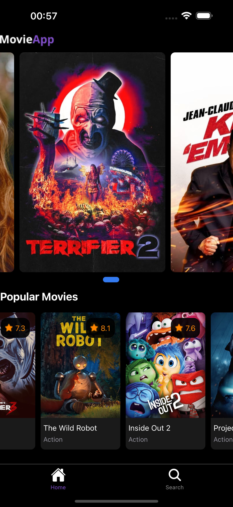
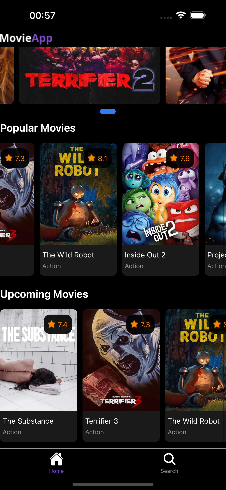
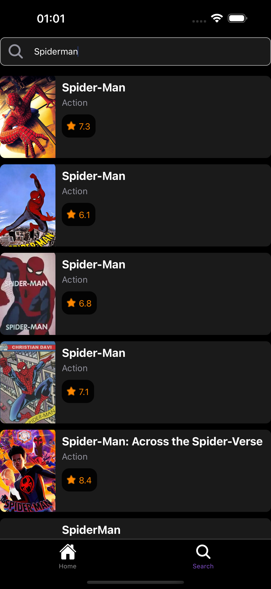
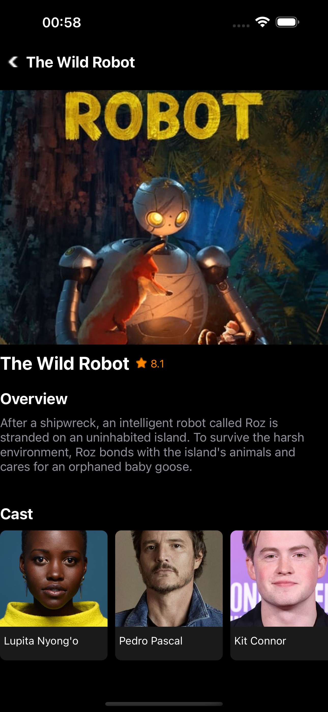
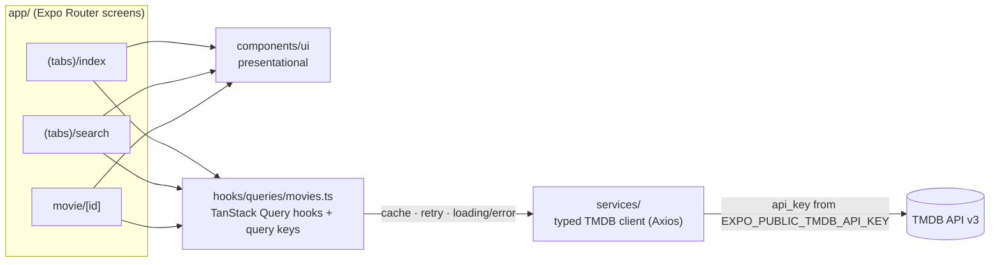

# Movie App (Expo)

[](https://github.com/eshginfarzali/movie-app-expo/actions/workflows/ci.yml)
[](LICENSE)


A cross-platform movie discovery app that lets you browse what's in cinemas, search TMDB and drill into cast and details — built with Expo Router, TanStack Query and a fully typed API layer.

<div align="center">
  
  
  
  
</div>

## Features

- **Home** — "Now Playing" poster carousel with animated pagination dots, plus horizontal **Popular** and **Upcoming** lists.
- **Search** — debounced (500 ms) TMDB search that starts after 3 characters.
- **Movie details** — poster, rating, genres, overview and a horizontal cast list.
- **Real genre labels** — genre IDs are resolved against TMDB's genre list (fetched once per session).
- **Caching & resilient UI** — every request goes through TanStack Query: cached for 5 minutes, one automatic retry, and per-section loading and error states with a "Try again" action.
- **File-based routing** with typed routes (Expo Router): tab navigator for Home / Search and a stack route for `movie/[id]`.

## Tech stack

| Area     | Choice                                                                         |
| -------- | ------------------------------------------------------------------------------ |
| Runtime  | Expo SDK 58, React Native 0.88, React 19                                       |
| Routing  | Expo Router (file-based, typed routes)                                         |
| Data     | TanStack Query v5, Axios, [TMDB API v3](https://developer.themoviedb.org/docs) |
| Language | TypeScript (`strict`)                                                          |
| Quality  | ESLint (`eslint-config-expo`), Prettier, Jest + React Native Testing Library   |
| Delivery | GitHub Actions CI, EAS Build                                                   |

## Architecture



- **Screens** only compose components and call query hooks — no `useEffect` fetching or manual loading flags.
- **`hooks/queries`** owns query keys (`movieKeys`) and caching rules, so screens share cached data.
- **`services/`** is the only place that knows about HTTP: `movie.ts` returns typed response bodies (`services/types.ts`), `errors.ts` maps failures to user-facing messages, `image.ts` builds TMDB image URLs.

```
app/              routes (tabs, movie/[id], +not-found)
components/ui/    presentational components
hooks/            useDebounce + TanStack Query hooks
lib/              QueryClient factory
services/         TMDB client, endpoints, types, error/image helpers
__tests__/        screen-level tests
docs/screenshots/ README images
```

## Getting started

### Prerequisites

- Node.js **22.13+** (see `.nvmrc`)
- A free [TMDB API key](https://www.themoviedb.org/settings/api)
- [Expo Go](https://expo.dev/go) on your phone, or an iOS Simulator / Android Emulator

### Setup

```bash
git clone https://github.com/eshginfarzali/movie-app-expo.git
cd movie-app-expo
npm install
cp .env.example .env   # then put your key in EXPO_PUBLIC_TMDB_API_KEY
npm start
```

Scan the QR code with Expo Go (Android) or the Camera app (iOS), or press `i` / `a` to open a simulator.

> `EXPO_PUBLIC_*` variables are inlined into the JavaScript bundle, so the TMDB key is visible to anyone with the app. That is acceptable for TMDB's free read-only key; never put a private secret in an `EXPO_PUBLIC_` variable.

## Try it

| Channel           | Link                                    |
| ----------------- | --------------------------------------- |
| Expo Go (dev)     | Run `npm start` and scan the QR code    |
| EAS preview build | _Coming soon — link will be added here_ |

### Building a preview with EAS

`eas.json` defines a `preview` profile (internal distribution, Android APK) and a `production` profile.

```bash
npm install -g eas-cli
eas login
eas init                                   # links the project and writes extra.eas.projectId
eas env:create --environment preview --name EXPO_PUBLIC_TMDB_API_KEY --value <your-key>
eas build --profile preview --platform android
```

## Scripts

| Script                 | Description                   |
| ---------------------- | ----------------------------- |
| `npm start`            | Start the Expo dev server     |
| `npm run android`      | Start and open on Android     |
| `npm run ios`          | Start and open on iOS         |
| `npm run web`          | Start and open in the browser |
| `npm run lint`         | ESLint (`expo lint`)          |
| `npm run format`       | Format with Prettier          |
| `npm run format:check` | Verify formatting             |
| `npm run typecheck`    | `tsc --noEmit`                |
| `npm test`             | Run the Jest suite            |
| `npm run test:watch`   | Jest in watch mode            |

## Testing

Tests use Jest (`jest-expo` preset) and React Native Testing Library:

- `services/__tests__` — TMDB image URL builder and HTTP error → message mapping.
- `hooks/__tests__` — `useDebounce` timing with fake timers.
- `components/ui/__tests__` — `Rating` formatting.
- `__tests__/search-screen.test.tsx` — the Search screen wired to a real `QueryClient` with a mocked service layer: minimum-length hint, rendered results with genre names, and error → retry.

```bash
npm test
npm test -- --coverage
```

CI (`.github/workflows/ci.yml`) runs install → lint → format check → typecheck → tests → `expo-doctor` on every push to `main` and every pull request.

## Roadmap

- [ ] Infinite scroll for search results and lists (`useInfiniteQuery`)
- [ ] Favorites / watchlist persisted on device
- [ ] Movie trailers and "similar movies" on the detail screen
- [ ] End-to-end tests with Maestro
- [ ] Publish an EAS preview build and link it above

## License

[MIT](LICENSE) © Eshgin Farzaliyev

This product uses the TMDB API but is not endorsed or certified by TMDB.
